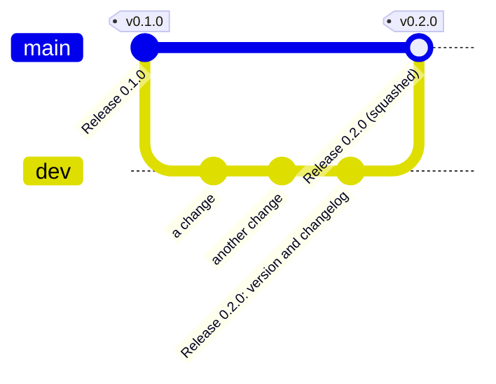

← [homelabdash](README.md)

# Contributing

## Setting up

You need Node.js 26 and git.

```sh
git clone https://github.com/xiaodoudou/homelabdash.git
cd homelabdash
npm install
```

The first `npm install` also builds the page into `dist/` and points git at `.githooks/`, where the `pre-commit` hook runs the privacy check, lint, the typecheck and the tests, and `commit-msg` checks your message (see [Commit messages](#commit-messages)).

Then list your own personal strings in `.privacy-denylist` at the root (it's gitignored, one per line), such as your domain, your LAN prefix and your user name. The privacy check refuses any commit that contains one of them.

## Running it

```sh
npm run dev             # the commented demo on http://localhost:3000, every service faked
npm run dev:showcase    # the full homelab of the screenshots
```

Both start Vite on port 3000 with hot reload of the page, in front of the server on 3001. The server restarts when `src/` changes, and picks up edits to the config and the builtin plugins without restarting. `PORT=3300 npm run dev` moves everything to another port.

`npm run build` builds the page into `dist/`, which is what `npm start` and the image serve. To try your own config: `node bin/homelabdash.js serve --config-dir path/to/config --data-dir path/to/data`.

## Tests

```sh
npm run check           # lint, typecheck, privacy check, all tests: what CI runs
npm test                # the server and plugin tests
npm run test:frontend   # the page tests (Vitest)
```

[docs/contributing/TESTING.md](docs/contributing/TESTING.md) says what each test file covers and how the fake services work. When a test fails, fix the cause rather than loosening the assertion until it passes.

## Screenshots of the documentation

The pictures in `docs/ui/` come from the showcase, through `npm run docs:screenshots`, and never from a real dashboard, because they must not show a real name, address or key. Retake them when a change alters how the page looks, and look at each one before you commit it.

## What CI checks

`.github/workflows/test.yml` runs on every push to `main` and `dev` and on every pull request:

- the commit messages, and the title of a pull request into `main`;
- lint, typecheck, the privacy check, the server, plugin and page tests, the build of the page and `npm audit` of the runtime dependencies, on Node 26;
- a secrets scan of the history (gitleaks);
- the Docker image: it builds, starts, answers its health check and loads every plugin.

## Project layout and naming conventions

[docs/contributing/ARCHITECTURE.md](docs/contributing/ARCHITECTURE.md) maps the code. A few conventions hold everywhere:

- The server and the plugins are plain JavaScript modules with JSDoc types. They have no build step, and there are no TypeScript sources.
- The page is made of Vue 3 single-file components in `web/src/components`, built by Vite. Anything that doesn't need Vue (formats, layout, view helpers) lives in plain modules next to them, tested in `test/frontend/`.
- A builtin plugin lives in `plugins/<id>/`, with `index.js`, `README.md`, `fixtures/*.json` and `plugin.test.js`, and its id is the folder name in lower case.
- Schemas are strict (`additionalProperties: false`) and carry their own defaults.
- A comment says why, in one line, and only where the code can't. Match how densely the file you're editing is commented.
- No em dashes, en dashes or middle dots anywhere: code, comments or docs.
- New core behaviour comes with a test in `test/`.

## Making a change

1. Branch from `dev`: `feat/<what>`, `fix/<what>`, `docs/<what>`.
2. Make the change with its test. For a plugin, update its README and fixtures too.
3. Add a line under **Unreleased** in `CHANGELOG.md` when users would notice the change.
4. `npm run check`.
5. Commit and open a pull request against `dev`.

## Commit messages

Commit messages follow [Conventional Commits 1.0.0](https://www.conventionalcommits.org/en/v1.0.0/):

```
<type>(<scope>): <description>

<body>

<footer>
```

The title is one line of 100 characters at most, with no final period, and says in the present tense what changes for someone running the dashboard or writing a plugin.

| Type | Use it for |
|---|---|
| `feat` | a new feature, or a change a user can see |
| `fix` | a bug fix |
| `docs` | documentation only |
| `style` | formatting and lint rules, with no change of behaviour |
| `refactor` | a change of the code that neither fixes a bug nor adds a feature |
| `perf` | a change that makes something faster or lighter |
| `test` | tests |
| `build` | the dependencies, the Dockerfile and the package |
| `ci` | the CI and release workflows |
| `chore` | anything else, and releases: `chore(release): 0.2.0` |
| `revert` | a revert |

The scope is the part the change is about, in lower case: a plugin id (`docker`, `unraid`, `tautulli`), or `config`, `runtime`, `server`, `web`, `cli`, `sdk`, `examples`, `release`. Leave it out when no part fits.

```
fix(docker): count a stopped container as stopped, not unhealthy
feat(web): merge the tiles of a group into one card
docs: explain why tiles stay empty behind a reverse proxy
ci: run the page tests in CI
```

A change that breaks existing configs or plugins gets a `!` before the colon, and a `BREAKING CHANGE:` footer that says what to do:

```
feat(config)!: rename the columns option of a section

BREAKING CHANGE: replace layout.cols with layout.columns in homelabdash.yaml.
```

The body explains why: what was wrong, what the change does about it, and anything a reviewer should know. The diff already shows what changed line by line.

### The check

`.githooks/commit-msg` refuses a message that does not follow these rules and says why. The rules are in `scripts/commitlint.js`, which has no dependency:

```sh
node scripts/commitlint.js --range origin/dev..HEAD    # the commits of a branch
node scripts/commitlint.js --title "fix: stop the crash"
```

The hook only helps the person who has it, so CI checks the same rules on every push and pull request. Merge commits, reverts made by git and the `fixup!` commits of an autosquash pass.

## Branches

`main` has one commit per version, each tagged (`v0.1.0`), and only release pull requests go into it. `dev` is where the work happens, with its commits as they were made. A change is a pull request against `dev`; a release is a pull request from `dev` to `main`, squashed into one commit.



## Pull requests

Open them against `dev`. Say what was wrong, what the change does and how you checked it. For anything visible, add screenshots of the showcase, in both themes if colours are involved. CI has to be green before review.

Security problems don't belong in a public issue or pull request; see [SECURITY.md](SECURITY.md#reporting-a-vulnerability).

## Releasing

A release is a tag on `main`. Any change worth mentioning gets a line under **Unreleased** in `CHANGELOG.md`, in the same commit, written for the person running the dashboard rather than in the words of the code.

1. **On `dev`**, a last commit titled `chore(release): 0.2.0` moves the Unreleased entries under a heading with the version and the date, adds the compare link at the bottom, and bumps the version in `package.json` and `.claude-plugin/plugin.json`. CI is green.
2. Open a pull request from `dev` to `main` titled `chore(release): 0.2.0`, with the new section of the changelog as its description, and squash-merge it.
3. Tag that commit and push the tag:

   ```sh
   git fetch origin
   git tag -a v0.2.0 -m "homelabdash 0.2.0" origin/main
   git push origin v0.2.0
   ```

4. Bring `dev` up to date with `main`, so the next release pull request shows only what came after. The squash commit holds what `dev` already has, so no file changes:

   ```sh
   git checkout dev
   git merge -s ours origin/main -m "chore: merge release 0.2.0 from main"
   git push origin dev
   ```

Pushing the tag starts `.github/workflows/release.yml`. It first checks that the tag names the version in `package.json`, sits on `main` and has a section in `CHANGELOG.md`. Then it runs the same jobs as every push, pushes the image to Docker Hub as `xiaodoudoufr/homelabdash` for amd64 and arm64 (logging in with the `DOCKERHUB_TOKEN` repository secret), and finally creates the GitHub release. Its notes are that changelog section, which `node scripts/release-notes.js 0.2.0` prints if you want to read them first, followed by the notes GitHub generates. If a step fails the rest don't run, so a red build never gets published. A prerelease tag such as `v0.3.0-rc.1` only gets its own image tag, and the release is marked as a prerelease.
