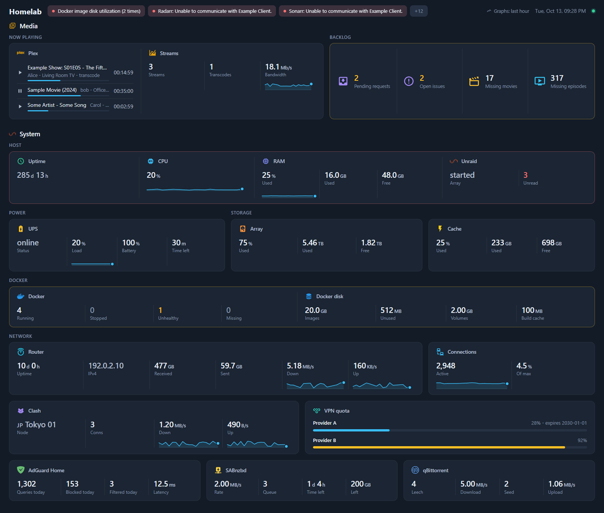

<div align="center">

# homelabdash

> A self-hosted dashboard for your homelab, where every tile comes from a small Node.js plugin

[](LICENSE) [](#try-it-in-five-minutes) [](docs/contributing/ARCHITECTURE.md) [](docs/operations/DEPLOY.md) [](docs/reference/PLUGINS.md) [](docs/contributing/TESTING.md)

You list your services in one YAML file and homelabdash keeps a page of live numbers about them: what Plex is playing, what the arrs are missing, how full the array is, what the router is pushing. Each service is read by a plugin, and a plugin is one JavaScript file you can write in an afternoon, or ask a coding agent to write.



</div>

---

The server polls each service on its own interval and pushes what changed to the page over a WebSocket, so nothing on screen waits for a reload, and a service is fetched once however many tiles show it. Logins, API keys, SSH, Docker events, cron jobs and buttons such as "pause downloads" all live inside the plugin, so you don't need helper scripts, extra containers or a crontab to feed the page. Keys and passwords never leave the server.

## Try it in five minutes

For a quick look you need [Node.js](https://nodejs.org/) 24 and git. The showcase runs against fake services, so you don't need any of them:

```sh
git clone https://github.com/xiaodoudou/homelabdash.git
cd homelabdash
npm install
npm run dev:showcase
```

Open <http://localhost:3000> and you get the page from the screenshot, fed by `dev/mock-upstreams.js`; the graphs fill in over the first few minutes.

To run it for real, use the image:

```sh
mkdir -p config data
docker run -d --name homelabdash -p 3000:3000 --user "$(id -u):$(id -g)" \
  -v "$PWD/config:/config" -v "$PWD/data:/data" \
  ghcr.io/xiaodoudou/homelabdash:latest
```

On first start it writes a starter `config/homelabdash.yaml`, and the page follows every save you make to it. [Deploying](docs/operations/DEPLOY.md) covers docker compose, Unraid, the Docker socket and reverse proxies.

## Your first tiles

A source is the connection to one service, and a tile shows one view of it.

```yaml
settings:
  title: Homelab

sources:
  nas:
    plugin: unraid
    config: { url: http://tower.example, apiKey: "${secret:UNRAID_API_KEY}" }
  docker:
    plugin: docker

sections:
  - { title: Alerts, source: alerts, placement: top }
  - title: Server
    tiles:
      - { title: CPU, icon: mdi:cpu-64-bit, source: nas, options: { metric: cpu }, graph: true }
      - { title: Array, icon: mdi:harddisk, source: nas, options: { metric: array } }
      - { title: Jellyfin, icon: si:jellyfin, href: http://media.example, container: jellyfin }
```

The API key goes in `config/secrets.yaml` as `UNRAID_API_KEY: ...` and never reaches the browser. `homelabdash validate` (or `docker exec homelabdash homelabdash validate`) checks the whole folder and prints each problem as `file:line path: message`. A typo won't take the page down either: the last good config keeps running and the page shows what's wrong.

[Concepts](docs/start/CONCEPTS.md) explains sources, tiles, groups, merged cards and graphs. The [config reference](docs/reference/CONFIG.md) has every key, and a table for moving over from gethomepage.

## Plugins

| Plugin | What it shows |
|---|---|
| [adguard](plugins/adguard) | Queries, blocked and filtered counts (today or over the retention), latency, top blocked domains |
| [apcupsd](plugins/apcupsd) | UPS status, load, battery and runtime; alerts when on battery |
| [arr](plugins/arr) | Missing items, queue and health of Radarr, Sonarr, Lidarr or Readarr |
| [docker](plugins/docker) | Container states kept live by Docker events, status dots, disk usage, optional start and stop |
| [glances](plugins/glances) | CPU, memory, load, GPU, sensors, disks and uptime |
| [http-json](plugins/http-json) | Any JSON API, several requests merged, JSONata for values |
| [mihomo](plugins/mihomo) | Current proxy node, connections and live traffic of mihomo (Clash Meta) |
| [npm](plugins/npm) | Nginx Proxy Manager hosts and certificates about to expire |
| [openwrt](plugins/openwrt) | WAN uptime, address and traffic, conntrack, load and memory over ubus |
| [qbittorrent](plugins/qbittorrent) | Leeching and seeding, speeds, active torrents, torrents in error |
| [sabnzbd](plugins/sabnzbd) | Rate, queue and time left, optional pause and resume |
| [seerr](plugins/seerr) | Pending requests and open issues of Overseerr, Jellyseerr or Seerr |
| [ssh](plugins/ssh) | Commands run over SSH on a schedule, and a live log tail |
| [sub-quota](plugins/sub-quota) | Traffic used and expiry of proxy subscriptions |
| [tautulli](plugins/tautulli) | Plex streams playing now, with a live countdown |
| [unraid](plugins/unraid) | CPU, memory, array, pools, uptime, notifications as alerts |

Each plugin's folder has a README with its options, and [the plugin list](docs/reference/PLUGINS.md) says which ones raise alerts or offer buttons.

## Your own plugins

A plugin is a folder with an `index.js`. It declares what it needs to connect and what a tile can show (both as JSON Schema), fetches data through `ctx.http`, `ctx.ssh` and friends, and turns that data into views the page already knows how to draw, without any frontend code.

```sh
homelabdash plugin new speedtest     # scaffold in config/plugins/speedtest, hot-reloaded
homelabdash plugin run speedtest     # what it renders, from recorded responses
homelabdash plugin test speedtest    # the contract check and its own tests
```

[Writing a plugin](docs/extending/PLUGINS.md) walks through it. The repository is also a Claude Code plugin marketplace: `/plugin marketplace add xiaodoudou/homelabdash` installs [three skills](skills/README.md) to write plugins, edit the config and deploy. [AGENTS.md](AGENTS.md) describes the codebase for any coding agent.

## Before you put it on the network

There's no login by default. Before anything you don't trust can reach the dashboard, either keep it to local addresses (with a VPN when you're away) or put it behind an identity proxy such as Authentik or Authelia. [SECURITY.md](SECURITY.md#who-should-reach-it) explains both and [Deploying](docs/operations/DEPLOY.md#who-can-reach-it) has the configs. Behind a reverse proxy, remember the page needs its WebSocket at `/api/ws`.

Buttons that change something upstream, such as pausing SABnzbd or approving a request, stay hidden until you turn them on for that source. Archiving an Unraid notification is the exception: it's on by default, and `notifications.archive: false` turns it off.

## Documentation

[docs/README.md](docs/README.md) is the map. A few places to start:

- [Getting started](docs/start/GETTING_STARTED.md) and [Concepts](docs/start/CONCEPTS.md)
- [Config reference](docs/reference/CONFIG.md), [Views and formats](docs/reference/VIEWS.md), [HTTP and WebSocket API](docs/reference/API.md), [CLI](docs/reference/CLI.md)
- [Deploying](docs/operations/DEPLOY.md) and [Troubleshooting](docs/operations/TROUBLESHOOTING.md)

## Contributing, security, license

[CONTRIBUTING.md](CONTRIBUTING.md) explains how to run the project, test it and send a change. Security problems go through private reporting, see [SECURITY.md](SECURITY.md), and what changed between versions is in [CHANGELOG.md](CHANGELOG.md).

homelabdash is released under the [Apache License 2.0](LICENSE).
