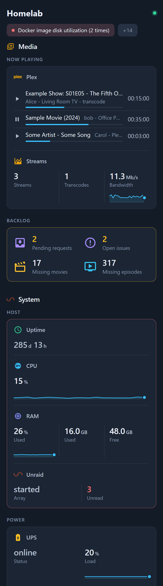
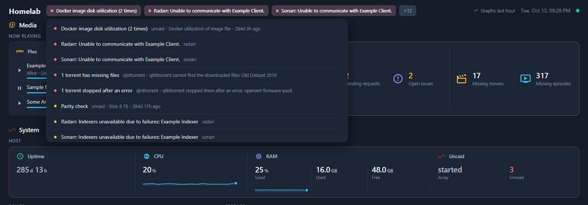

← [Documentation](../README.md)

# Concepts

## Sources and tiles

A source is one connection to one service: a plugin plus the settings it needs (URL, API key, password). The server fetches it on its own interval, once, however many tiles read from it, so five tiles about the same Unraid server cost one request.

A tile shows one view of a source, and its `options` pick which. The `unraid` plugin can show CPU, memory, the array, a pool, uptime or notifications, so five tiles on the same source with five different `metric` options are five different tiles.

```yaml
sources:
  nas:
    plugin: unraid
    interval: 15s
    config: { url: http://tower.example, apiKey: "${secret:UNRAID_API_KEY}" }

sections:
  - title: Server
    tiles:
      - { title: CPU, source: nas, options: { metric: cpu } }
      - { title: Array, source: nas, options: { metric: array } }
```

A tile with an `href` and no source is just a link. Any tile can also carry a status dot from another source: `container: plex` asks the `docker` source whether the `plex` container is up, and the dot only appears when it isn't.

## How a page is laid out

A page is a list of sections. A section holds tiles, or groups (`sections:` inside a section, one level deep), which sit side by side under the section title, each with a small heading of its own.

There are no column counts to set. The browser draws each group as wide as its content, so a tile with four numbers is wider than a link, and numbers keep room for their widest value (100%, 888.8 GB) so tiles do not jump when a value goes from 9 to 10. The page then cuts the groups into rows as evenly as it can, in the order of the config, and each row is filled exactly: the groups of a row share what is left. A group that is too narrow for its numbers wraps them onto more rows (four as 2x2) rather than cutting them off. While the page is open a row only changes when a group grows. `width: 45%` sets a group's share yourself ([Setting widths](../reference/CONFIG.md#setting-widths)), `span: 2` makes a tile at least twice as wide as a small one, and `span: full` gives it the whole row.

A section with `layout: { columns: 4 }` or `layout: { minTileWidth: 220 }` switches to a plain grid instead.

### Merged cards

`merge: true` on a group draws its tiles as one card, with a divider between them. When the numbers belong together, that reads better than four small tiles:

```yaml
- title: Backlog
  merge: true
  tiles:
    - { title: Pending requests, icon: mdi:inbox-arrow-down, source: seerr, options: { stats: [pending] } }
    - { title: Open issues, icon: mdi:alert-circle-outline, source: seerr, options: { stats: [issues] } }
    - { title: Missing movies, icon: mdi:movie-open-outline, source: radarr, options: { view: missing } }
    - { title: Missing episodes, icon: mdi:television-play, source: sonarr, options: { view: missing } }
```

If every tile shows a single number, each one becomes a compact cell with a large icon, the value and the title. Otherwise every tile keeps its whole view under a small heading; that's how the list of streams and the stream counts share one card in the showcase. Each cell keeps its own source and link. On a phone the cells stack, or pair up two by two when they're single numbers.



## Alerts

Plugins raise alerts for things worth a look, like a container that should be running and isn't, a disk filling up, a torrent with missing files or an Unraid notification. The builtin `alerts` source gathers them all:

```yaml
- { title: Alerts, source: alerts, placement: top }
```

With `placement: top` they show up as chips in the header, so the page below doesn't move when one comes or goes. Clicking a chip opens the full list, with each alert's buttons.



Dismissing an alert hides it until it stops firing. The dismissal is kept on the server, so it holds in every browser and across restarts, and if the alert clears and comes back later it shows again. Some alerts bring buttons of their own, such as Archive on an Unraid notification.

## Graphs

`graph: true` on a tile keeps an hour of history for each of its numbers, one point every 10 seconds, and draws it as a line under the value; `graph: [Down, Up]` limits that to the stats with those labels. The history lives in `/data` and survives a restart. Percentages use a fixed 0 to 100 scale and temperatures run from 20 °C to the critical threshold, so a little noise never looks like a spike. Hover a line to see a value and how long ago it was.

## How the page stays live

The browser opens a single WebSocket and the server pushes tiles to it when they change, so the page itself never polls. If the connection drops, or goes quiet for 45 seconds (a laptop that slept, a network change), the page reconnects and gets every tile again.

On the server, each source runs on its `interval`, or `settings.defaultInterval` (30 seconds) when neither the source nor its plugin sets one. With no browser connected, sources slow down to `settings.idleInterval` (5 minutes), and opening the page brings them back up to speed.

Some plugins also stream. The `docker` plugin follows Docker events, `ssh` can follow a log with `tail -F`, and `mihomo` reads live traffic. A stream updates its tiles as things happen, and only runs while a page is open.

Plugins can own jobs too: cron-style tasks for slow work, like Docker's disk usage every 30 minutes. If a job missed its slot while the dashboard was down, it runs once at start, and a source can change a job's schedule or switch it off.

## When something fails

When a source fails, its tiles show the error. If it had data before, they keep the last values with a "stale" badge while the source retries, waiting a little longer each time, up to 5 minutes. Other sources carry on: each plugin runs in its own worker thread, so even one that crashes or hangs only takes its own tiles down.

The config is checked against a schema on every save. A mistake inside one source or tile switches off only that source or tile and shows the error on the page, and a file that can't be read at all leaves the last good config running.

## Secrets

`${secret:NAME}` in a source's `config` reads `NAME` from `secrets.yaml`, from an environment variable `HOMELABDASH_SECRET_NAME`, or from a Docker secret file `/run/secrets/NAME`. It's resolved on the server, the page never receives a source's config, and secret values are scrubbed from errors and logs. Anywhere else in the file a secret is refused, because other values do reach the browser.
