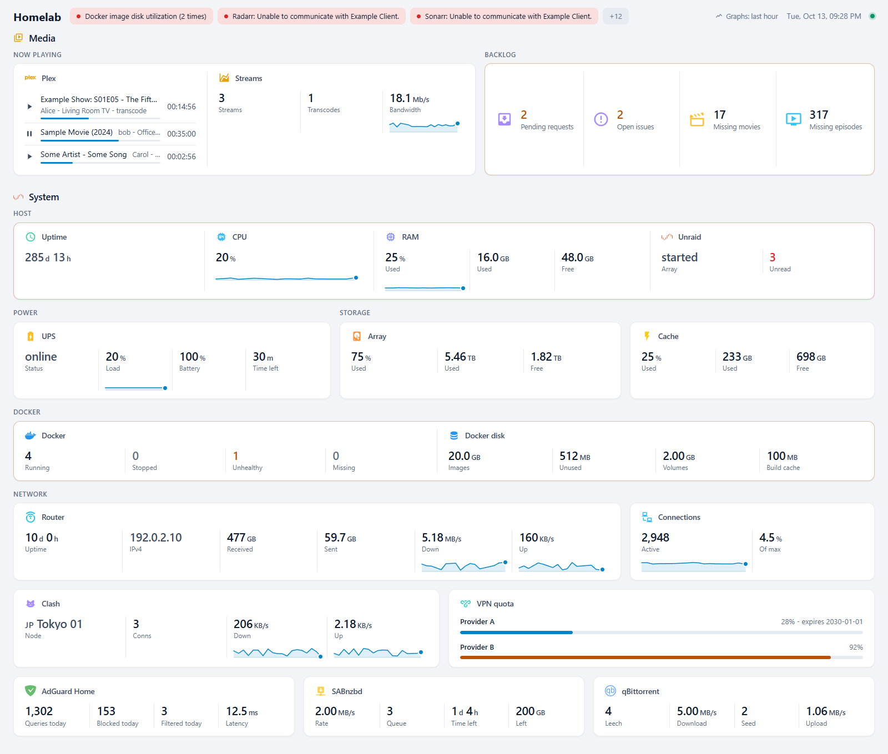

← [Documentation](../README.md)

# Getting started

## Look at it first

With Node.js 26 and git:

```sh
git clone https://github.com/xiaodoudou/homelabdash.git
cd homelabdash
npm install
npm run dev:showcase
```

<http://localhost:3000> then shows a full homelab: Plex, the arrs, an Unraid server, a UPS, Docker, an OpenWrt router, AdGuard and two download clients. None of it is real; `dev/mock-upstreams.js` answers for every service with recorded responses and nudges the numbers a little, so the graphs and live updates have something to show. The config behind it, [`examples/showcase/homelabdash.yaml`](../../examples/showcase/homelabdash.yaml), is a good file to copy from.



`npm run dev` runs a smaller demo instead, [`examples/config`](../../examples/config/homelabdash.yaml), with a comment on most keys.

## Run your own

The image is `xiaodoudoufr/homelabdash` on Docker Hub, for amd64 and arm64. It needs two folders: `/config` for what you edit, and `/data` for what the dashboard writes itself (dismissed alerts, plugin state, graph history, cached icons).

```sh
mkdir -p config data
docker run -d --name homelabdash -p 3000:3000 --user "$(id -u):$(id -g)" \
  -v "$PWD/config:/config" -v "$PWD/data:/data" \
  xiaodoudoufr/homelabdash:latest
```

On first start it writes a starter `config/homelabdash.yaml`. Open <http://localhost:3000> and start editing the file; the page follows every save.

For docker compose, Unraid, the Docker socket and reverse proxies, see [Deploying](../operations/DEPLOY.md).

## Add a service

Say you run Sonarr. Its plugin is `arr`, and like every plugin it has a README with its settings: [`plugins/arr/README.md`](../../plugins/arr/README.md) says it needs a URL and an API key.

1. Put the key in `config/secrets.yaml`:

   ```yaml
   SONARR_API_KEY: paste-the-key-from-sonarr-settings
   ```

2. Add a source and a tile to `config/homelabdash.yaml`:

   ```yaml
   sources:
     sonarr:
       plugin: arr
       config: { url: http://sonarr.example:8989, apiKey: "${secret:SONARR_API_KEY}" }

   sections:
     - title: Media
       tiles:
         - { title: Missing episodes, icon: mdi:television-play, href: http://sonarr.example:8989/wanted/missing, source: sonarr, options: { view: missing } }
   ```

3. Check it:

   ```sh
   docker exec homelabdash homelabdash validate
   ```

   It prints `ok`, or one line per problem with the file, the line and the path of the key. Typos such as `optoins` or `view: mising` get caught here, since every plugin describes its settings with a schema.

The tile shows up as soon as you save. If it shows an error instead of a number, the message is what the service answered, and [Troubleshooting](../operations/TROUBLESHOOTING.md) goes through the usual causes.

## Coming from gethomepage

Most of a homepage `services.yaml` carries over directly: groups become sections, `href`, `icon` and `description` keep their names, and `server` + `container` becomes `container:` on the tile. The [config reference](../reference/CONFIG.md#coming-from-gethomepage) has the full table. Keep homepage running until the new page shows the same numbers.

## Make it your new tab page

Chrome has no setting for the page a new tab opens, so this takes an extension. [New Tab Redirect](https://chromewebstore.google.com/detail/new-tab-redirect/icpgjfneehieebagbmdbhnlpiopdcmna) does the job in Chrome and in Brave, which installs extensions from the same Chrome Web Store.

1. Install it, then open its options.
2. Put the address you open the dashboard at in **Redirect URL**, for example `https://dash.example`, and click **Save**.
3. Tick **Always update tab, not redirect**. The extension notes that this keeps the cursor in the address bar, so you can still start typing a search or an address in a new tab.

If you only let local addresses reach the dashboard (see [Who can reach it](../operations/DEPLOY.md#who-can-reach-it)), new tabs will show an error while you're away from home and off your VPN.

## Next

- [Concepts](CONCEPTS.md): how sources, tiles, groups, merged cards and graphs fit together.
- [Config reference](../reference/CONFIG.md): every key.
- [Writing a plugin](../extending/PLUGINS.md): when no builtin plugin fits.
